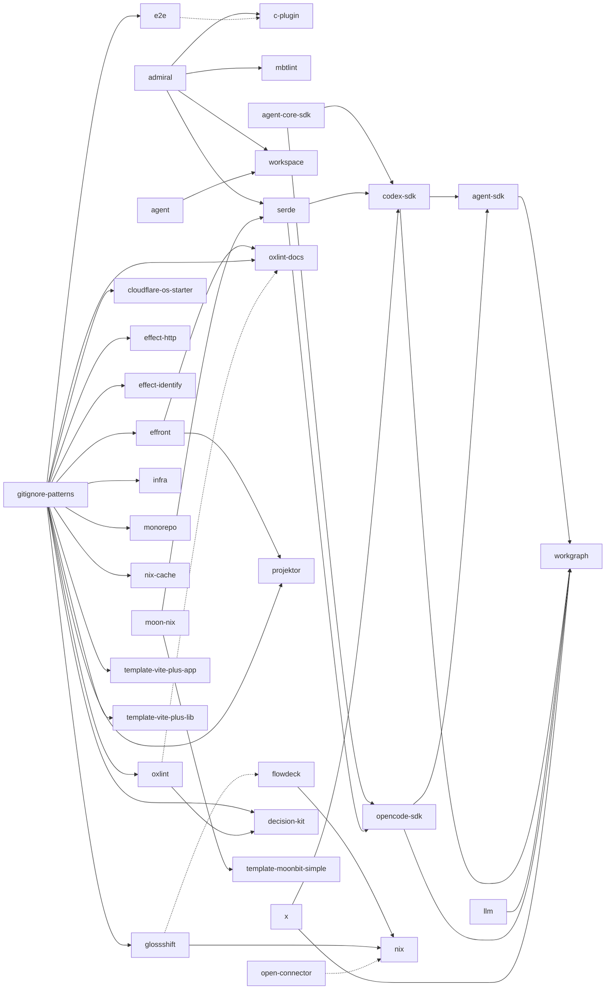

# Workspace repository dependencies

[dependencies.json](dependencies.json) contains the source evidence. Follow the [maintenance procedure](maintenance.md) to regenerate this diagram and table with the MoonBit script.

48 repositories, 80 dependency pairs. Arrows point from the provider to the consumer. Solid arrows show pinned references that may need an update. Dotted arrows show relationships to verify or review.

## Package, tool, and operational relationships

Shared CI dependencies appear only in the table and JSON. If a pair has more than one relationship, the diagram uses a solid arrow when any displayed relationship is pinned.

## Providers and consumers

| Provider | Consumer | Relationship | Evidence files |
| --- | --- | --- | --- |
| `admiral` | `c-plugin` | mooncakes: pin | `moon.mod` |
| `admiral` | `mbtlint` | mooncakes: pin | `moon.mod` |
| `admiral` | `serde` | nix: pin, mooncakes: pin | `flake.lock`, `src/cmd/serde-gen/moon.mod` |
| `admiral` | `workspace` | mooncakes: pin | `.agents/skills/workspace-dependencies/scripts/dependencies.mbtx` |
| `agent` | `workspace` | skills: pin | `skills-lock.json` |
| `agent-core-sdk` | `codex-sdk` | mooncakes: pin | `moon.mod` |
| `agent-core-sdk` | `opencode-sdk` | mooncakes: pin | `moon.mod` |
| `agent-sdk` | `workgraph` | mooncakes: pin | `package/workgraph-agent-cli/moon.mod`, `package/workgraph-codex-cli/moon.mod`, `package/workgraph-opencode-cli/moon.mod` |
| `codex-sdk` | `agent-sdk` | mooncakes: pin | `moon.mod` |
| `codex-sdk` | `workgraph` | mooncakes: pin | `package/workgraph-codex-cli/moon.mod` |
| `e2e` | `c-plugin` | contract: review | `AGENTS.md` |
| `effront` | `oxlint-docs` | npm: pin | `package.json` |
| `effront` | `projektor` | npm: pin | `package.json` |
| `flowdeck` | `nix` | nix: pin | `share/my/flake.lock` |
| `gitignore-patterns` | `cloudflare-os-starter` | npm: pin | `package.json` |
| `gitignore-patterns` | `decision-kit` | npm: pin | `package.json` |
| `gitignore-patterns` | `e2e` | npm: pin | `package.json` |
| `gitignore-patterns` | `effect-http` | npm: pin | `package.json` |
| `gitignore-patterns` | `effect-identify` | npm: pin | `package.json` |
| `gitignore-patterns` | `effront` | npm: pin | `package.json`, `app/docs/package.json`, `examples/basic/package.json`, `examples/loading/package.json`, `examples/markdown/package.json`, `packages/create-effront/templates/bun/package.json`, `packages/create-effront/templates/node/package.json`, `packages/create-effront/templates/cloudflare/package.json`, `packages/create-effront/templates/alchemy-cloudflare/package.json` |
| `gitignore-patterns` | `glossshift` | npm: pin | `package.json` |
| `gitignore-patterns` | `infra` | npm: pin | `package.json` |
| `gitignore-patterns` | `monorepo` | npm: pin | `package.json` |
| `gitignore-patterns` | `nix-cache` | npm: pin | `package.json` |
| `gitignore-patterns` | `oxlint` | npm: pin | `package.json` |
| `gitignore-patterns` | `oxlint-docs` | npm: pin | `package.json` |
| `gitignore-patterns` | `projektor` | npm: pin | `package.json` |
| `gitignore-patterns` | `template-vite-plus-app` | npm: pin | `package.json` |
| `gitignore-patterns` | `template-vite-plus-lib` | npm: pin | `package.json` |
| `glossshift` | `flowdeck` | contract: review | `src/workflows/jcode_translation/glossshift.rs` |
| `glossshift` | `nix` | nix: pin | `share/my/macos/flake.lock` |
| `llm` | `workgraph` | mooncakes: pin | `package/workgraph-llm/moon.mod` |
| `monorepo` | `admiral` | github-actions: verify | `.github/workflows/ci.yml`, `.github/workflows/publish.yml` |
| `monorepo` | `agent` | github-actions: verify | `.github/workflows/ci.yml` |
| `monorepo` | `agent-core-sdk` | github-actions: verify | `.github/workflows/ci.yml`, `.github/workflows/publish.yml` |
| `monorepo` | `agent-sdk` | github-actions: verify | `.github/workflows/ci.yml`, `.github/workflows/publish.yml` |
| `monorepo` | `atlas-to-kysely` | github-actions: verify | `.github/workflows/ci.yml`, `.github/workflows/flakehub-publish-rolling.yml` |
| `monorepo` | `c-plugin` | github-actions: verify | `.github/workflows/ci.yml` |
| `monorepo` | `codex-sdk` | github-actions: verify | `.github/workflows/ci.yml`, `.github/workflows/publish.yml` |
| `monorepo` | `decision-kit` | github-actions: verify | `.github/workflows/ci.yml`, `.github/workflows/publish.yml` |
| `monorepo` | `e2e` | github-actions: verify | `.github/workflows/ci.yml`, `.github/workflows/publish.yml` |
| `monorepo` | `effect-http` | github-actions: verify | `.github/workflows/ci.yml`, `.github/workflows/publish.yml` |
| `monorepo` | `effect-identify` | github-actions: verify | `.github/workflows/ci.yml`, `.github/workflows/publish.yml` |
| `monorepo` | `effront` | github-actions: verify | `.github/workflows/ci.yml`, `.github/workflows/publish.yml`, `.github/workflows/deploy-docs.yml` |
| `monorepo` | `flowdeck` | github-actions: pin, github-actions: verify | `.github/workflows/ci.yml`, `.github/workflows/flakehub-publish-rolling.yml` |
| `monorepo` | `geo` | github-actions: verify | `.github/workflows/ci.yml`, `.github/workflows/publish.yml` |
| `monorepo` | `gitignore-patterns` | github-actions: verify | `.github/workflows/ci.yml`, `.github/workflows/publish.yml` |
| `monorepo` | `glossshift` | github-actions: verify | `.github/workflows/ci.yml`, `.github/workflows/flakehub-publish-rolling.yml` |
| `monorepo` | `infra` | github-actions: verify | `.github/workflows/ci.yml` |
| `monorepo` | `lens` | github-actions: verify | `.github/workflows/ci.yml`, `.github/workflows/publish.yml` |
| `monorepo` | `llm` | github-actions: verify | `.github/workflows/ci.yml`, `.github/workflows/publish.yml`, `.github/workflows/copilot-setup-steps.yml` |
| `monorepo` | `llm-profiles` | github-actions: verify | `.github/workflows/ci.yml`, `.github/workflows/publish.yml` |
| `monorepo` | `mbtlint` | github-actions: verify | `.github/workflows/ci.yml`, `.github/workflows/publish.yml` |
| `monorepo` | `serde` | github-actions: verify | `.github/workflows/ci.yml` |
| `monorepo` | `moonbit-overlay` | github-actions: verify | `.github/workflows/flakehub-publish-rolling.yml` |
| `monorepo` | `nix-cache` | github-actions: verify | `.github/workflows/ci.yml` |
| `monorepo` | `opencode-sdk` | github-actions: verify | `.github/workflows/ci.yml`, `.github/workflows/publish.yml` |
| `monorepo` | `oxlint` | github-actions: verify | `.github/workflows/ci.yml`, `.github/workflows/publish.yml` |
| `monorepo` | `oxlint-docs` | github-actions: verify | `.github/workflows/ci.yml`, `.github/workflows/deploy-docs.yml` |
| `monorepo` | `projektor` | github-actions: verify | `.github/workflows/ci.yml`, `.github/workflows/deploy.yml` |
| `monorepo` | `reylo` | github-actions: verify | `.github/workflows/publish.yml` |
| `monorepo` | `template-go-simple` | github-actions: verify | `.github/workflows/ci.yml` |
| `monorepo` | `template-haskell-simple` | github-actions: verify | `.github/workflows/ci.yml` |
| `monorepo` | `template-moonbit-simple` | github-actions: verify | `.github/workflows/ci.yml` |
| `monorepo` | `template-rust-simple` | github-actions: verify | `.github/workflows/ci.yml` |
| `monorepo` | `template-vite-plus-app` | github-actions: verify | `.github/workflows/ci.yml` |
| `monorepo` | `template-vite-plus-lib` | github-actions: verify | `.github/workflows/ci.yml` |
| `monorepo` | `workgraph` | github-actions: verify | `.github/workflows/ci.yml`, `.github/workflows/publish.yml` |
| `monorepo` | `x` | github-actions: verify | `.github/workflows/ci.yml`, `.github/workflows/publish.yml` |
| `moon-nix` | `serde` | nix: pin | `flake.lock` |
| `moon-nix` | `template-moonbit-simple` | nix: pin | `flake.lock` |
| `open-connector` | `nix` | contract: review | `share/packages-scripts.nix` |
| `opencode-sdk` | `agent-sdk` | mooncakes: pin | `moon.mod` |
| `opencode-sdk` | `workgraph` | mooncakes: pin | `package/workgraph-opencode-cli/moon.mod` |
| `oxlint` | `decision-kit` | npm: pin | `package.json` |
| `oxlint` | `oxlint-docs` | contract: review | `README.md` |
| `serde` | `codex-sdk` | mooncakes: pin | `moon.mod` |
| `serde` | `opencode-sdk` | mooncakes: pin | `moon.mod` |
| `x` | `codex-sdk` | mooncakes: pin | `moon.mod` |
| `x` | `workgraph` | mooncakes: pin | `package/workgraph-core/moon.mod`, `package/workgraph-agent-cli/moon.mod` |

Evidence paths are relative to the consumer repository. See the JSON inventory for reference values and unresolved dependencies.

## Repositories

| ID | Workspace path | Status |
| --- | --- | --- |
| `x` | `package/x` | mapped |
| `e2e` | `package/e2e` | mapped |
| `geo` | `package/geo` | mapped |
| `llm` | `fork/package/llm` | mapped |
| `nix` | `nix` | mapped |
| `www` | `app/www` | local |
| `lens` | `package/lens` | mapped |
| `mdts` | `app/mdts` | mapped |
| `agent` | `agent` | mapped |
| `infra` | `infra` | mapped |
| `reylo` | `fork/package/reylo` | mapped |
| `serde` | `package/serde` | mapped |
| `oxlint` | `package/oxlint` | mapped |
| `admiral` | `package/admiral` | mapped |
| `effront` | `package/effront` | mapped |
| `mbtlint` | `package/mbtlint` | mapped |
| `tui.mbt` | `fork/package/tui.mbt` | mapped |
| `c-plugin` | `app/c-plugin` | mapped |
| `flowdeck` | `app/flowdeck` | mapped |
| `monorepo` | `monorepo` | mapped |
| `moon-nix` | `fork/package/moon-nix` | mapped |
| `agent-sdk` | `package/agent-sdk/agent-sdk` | mapped |
| `codex-sdk` | `package/agent-sdk/codex-sdk` | mapped |
| `nix-cache` | `app/nix-cache` | mapped |
| `projektor` | `app/projektor` | mapped |
| `workgraph` | `package/workgraph` | mapped |
| `workspace` | `.` | root |
| `glossshift` | `app/glossshift` | mapped |
| `effect-http` | `package/effect-http` | mapped |
| `oxlint-docs` | `app/oxlint-docs` | mapped |
| `syntree.mbt` | `fork/package/syntree.mbt` | mapped |
| `decision-kit` | `package/decision-kit` | mapped |
| `llm-profiles` | `package/llm-profiles` | mapped |
| `opencode-sdk` | `package/agent-sdk/opencode-sdk` | mapped |
| `agent-core-sdk` | `package/agent-sdk/agent-core-sdk` | mapped |
| `open-connector` | `fork/app/open-connector` | mapped |
| `atlas-to-kysely` | `app/atlas-to-kysely` | mapped |
| `effect-identify` | `package/effect-identify` | mapped |
| `moonbit-overlay` | `toolchain/moonbit-overlay` | mapped |
| `lapriere-website` | `app/lapriere-website` | local |
| `gitignore-patterns` | `package/gitignore-patterns` | mapped |
| `template-go-simple` | `template/go-simple` | mapped |
| `template-rust-simple` | `template/rust-simple` | mapped |
| `cloudflare-os-starter` | `fork/app/cloudflare-os-starter` | mapped |
| `template-vite-plus-app` | `template/vite-plus-app` | mapped |
| `template-vite-plus-lib` | `template/vite-plus-lib` | mapped |
| `template-haskell-simple` | `template/haskell-simple` | mapped |
| `template-moonbit-simple` | `template/moonbit-simple` | mapped |
